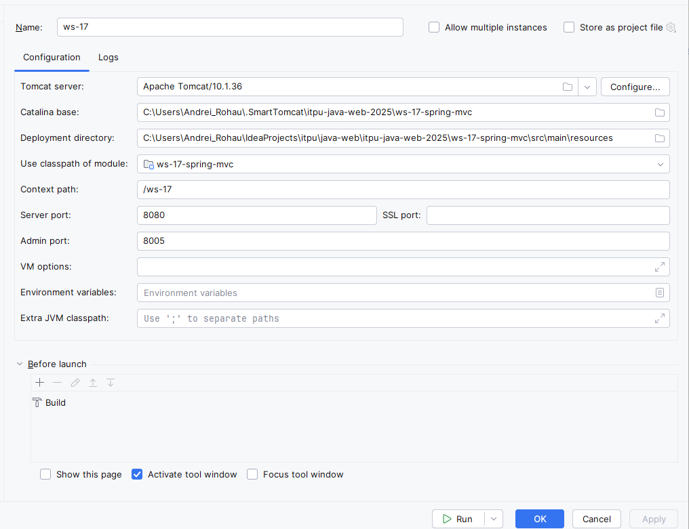

# spring-mvc

##
FrontController servlet
DispatcherServlet
Webmvc
viewresolver
appInitializer
webappcontext

model
template resolution
controller methods

##

- Install JDK 21, Maven, and Tomcat 10.1 (Servlet 6 compatible).
- In VS Code, install Extension Pack for Java and Tomcat.
- Open the ws-17-spring-mvc folder.
- In Tomcat’s Manage Instances, add your Tomcat installation and select Maven - as the build type.
- In the terminal, run mvn -DskipTests package.
- Deploy target/ws-17.war from the Tomcat view and open http://localhost:8080/ws-17/home.

## ws-17-spring-mvc
- [Spring: Spring MVC](https://www.linkedin.com/learning/spring-spring-mvc-2/why-use-spring-mvc?autoSkip=true&resume=false&u=2113185)
- [Overview of Thymeleaf](https://www.linkedin.com/learning/spring-web-mvc-6/overview-of-thymeleaf?u=2113185)
- [Spring Guides](https://spring.io/guides)
- 
- 

___

